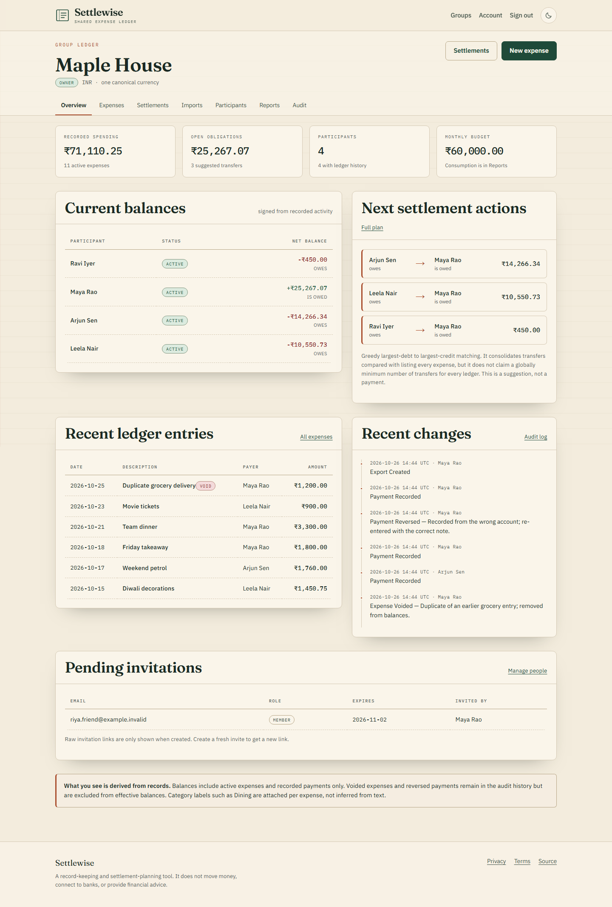
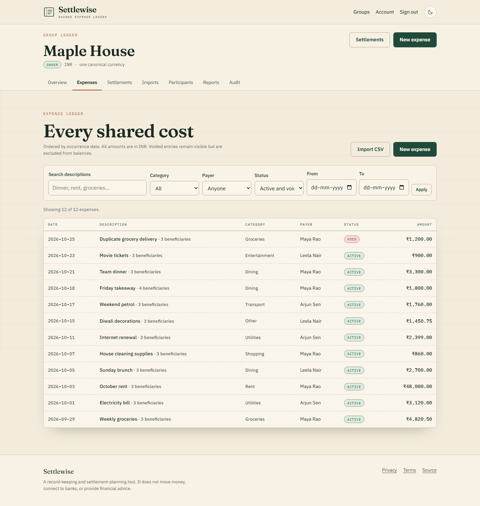
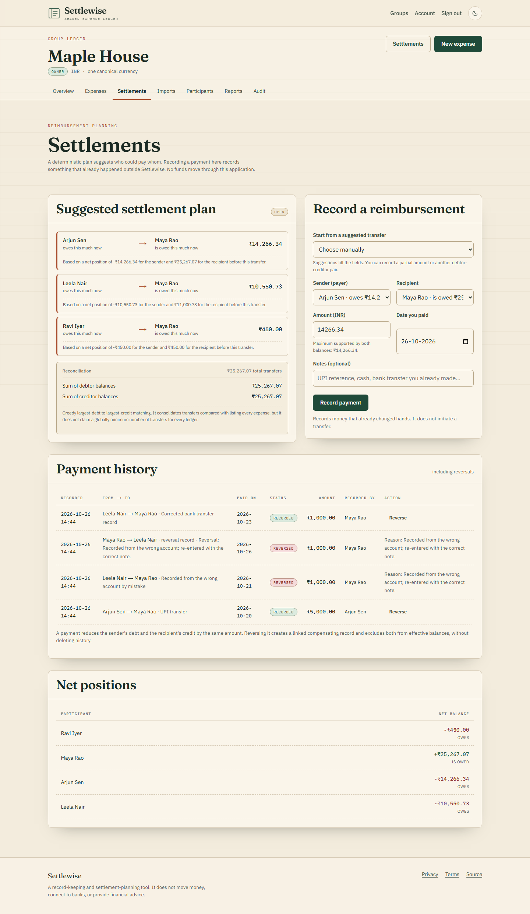
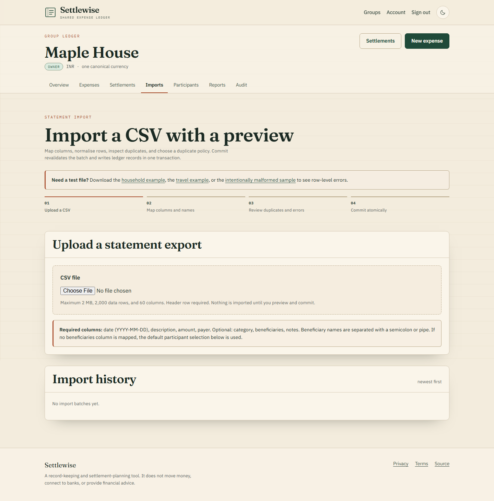
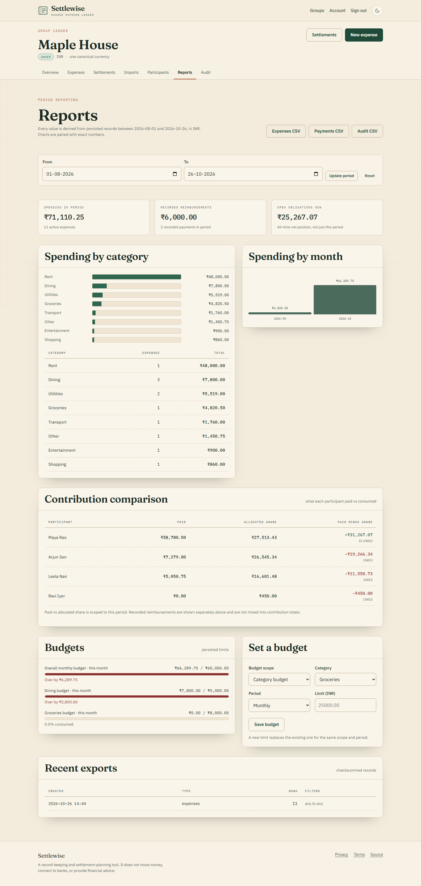
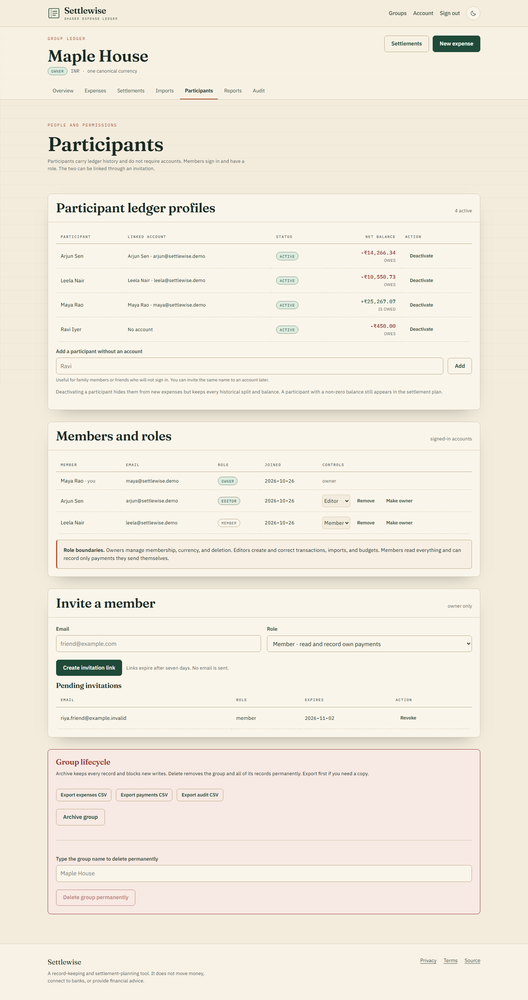

# Settlewise

Settlewise is a shared-expense ledger for households, roommates, travel groups, and informal clubs. It
records who paid and who benefited, derives exact signed balances, preserves every correction, maps CSV
statements through a reviewable import, and produces an explainable settlement plan.

It is a record-keeping and settlement-planning application. It does not connect to banks, process
payments, move money, or provide financial advice.

[](https://settlewise-psi.vercel.app)


## Live demo

**Open:** <https://settlewise-psi.vercel.app>

**Demo account:** `maya@settlewise.demo`  
**Demo password:** `settlewise-demo-2026`

The demo is a real Next.js deployment backed by PostgreSQL. It contains two fictional groups, twelve
household ledger entries, five imported travel entries, budgets, one expense correction, one voided
duplicate, one reversed reimbursement, and a corrected replacement payment. The shared demo account is
intended for evaluation only. Do not enter real names or financial records.



## Why it exists

Most split calculators show a number but cannot explain it. Settlewise treats the ledger as the source of
truth:

- Money is stored as integer minor units, never floating point.
- Equal, exact, percentage, and weighted splits always sum to the expense total.
- Residual minor units follow one documented largest-remainder rule.
- Edits require the expected revision and write before/after snapshots.
- Voided expenses and reversed payments remain visible but leave effective balances.
- CSV uploads are previewed, mapped, duplicate-checked, then committed atomically.
- Owners, editors, and members have server-enforced permissions.
- A settlement plan reconciles every transfer to the remaining signed balances.

## Screenshots

| Expense ledger | Settlement plan | Import preview |
| --- | --- | --- |
|  |  |  |

| Reports | Participants |
| --- | --- |
|  |  |

## Features

### Ledger and balances

- Groups with one canonical currency and optional monthly budget.
- Account members plus non-account participants.
- Searchable, filterable, paginated expense ledger.
- Signed balances with textual owes/is owed labels, not color alone.
- Category, monthly, and participant contribution reports.
- Overall and category budget consumption.
- CSV exports for expenses, settlements, and audit history.

### Corrections and reversals

- Expense revision numbers with stale-write rejection.
- Append-only before/after snapshots and reasons.
- Voiding that excludes an expense from balances while retaining history.
- Partial reimbursement recording with sender and recipient validation.
- Reversal as a linked compensating record.
- Actor, action, target, reason, revision, and timestamp audit trail.

### Imports

- Bounded RFC 4180 parser.
- Column mapping and name mapping.
- Row-level normalization and validation errors.
- Fingerprint-based possible duplicate detection across existing records and within the file.
- Explicit skip or import-anyway duplicate policy.
- Creator-owned preview with expiry and atomic commit.
- Sample valid and malformed CSV files under `/samples`.

### Accounts and safety

- scrypt password hashing.
- Opaque session tokens stored only as hashes.
- 30-day sessions with per-session revocation.
- Expiring, email-bound invitation tokens.
- Server-side OWNER, EDITOR, and MEMBER checks.
- Same-origin checks for cookie-authenticated mutations.
- Database-backed rate limiting.
- CSP and security headers.
- Account JSON export and anonymizing deletion path.

## Supported currencies

| Code | Currency | Minor units | Decimal places |
| --- | --- | --- | --- |
| INR | Indian rupee | paisa | 2 |
| USD | US dollar | cent | 2 |
| EUR | Euro | cent | 2 |
| GBP | British pound | penny | 2 |
| JPY | Japanese yen | yen | 0 |
| KWD | Kuwaiti dinar | fils | 3 |

Currency precision is explicit. A group cannot mix currencies, and changing currency after financial
records exist is blocked.

## Allocation and rounding

For total `T` in minor units:

| Method | Calculation | Residual rule |
| --- | --- | --- |
| EQUAL | `floor(T / n)` | First recipients by ascending participant ID receive one extra unit |
| EXACT | user-entered shares | Must sum exactly to `T` |
| PERCENT | integer basis points summing to 10,000 | Largest fractional remainder, ties by participant ID |
| SHARES | positive integer weights | Largest fractional remainder, ties by participant ID |

The browser preview and server use the same pure allocation function. The server always recomputes the
result before persistence.

## Settlement semantics

Net balance:

```text
participant net =
  sum(active expenses they paid)
  - sum(allocated shares of active expenses they benefited from)
  + sum(recorded payments they sent)
  - sum(recorded payments they received)
```

Every active ledger must sum to zero. The planner sorts debtors and creditors by amount descending, then
participant ID ascending, and matches the current largest debtor with the current largest creditor. Each
row shows sender, recipient, amount, and the balances before that transfer.

The strategy is deterministic and consolidates transfers compared with listing every expense. It does not
claim a globally minimum number of transfers for every possible ledger. The result is a suggested plan.
Recording a payment updates records; it does not initiate money movement.

## Architecture

Next.js App Router, React 19, strict TypeScript, PostgreSQL, Drizzle ORM, Zod, Vitest, and Playwright.

```text
src/
  app/            pages, server actions, API handlers, loading/error states
  components/     ledger, split editor, import workspace, forms
  domain/         pure money, allocation, settlement rules
  services/       authorized transactions, imports, reports, exports
  repositories/   tenant-scoped database reads
  importers/      CSV parser, normalization, fingerprints
  validation/     request schemas
  auth/           sessions, RBAC, invitations, rate limits
  db/             Drizzle schema, pool, migrations
```

The database uses BIGINT minor units and composite foreign keys so an expense currency must match its
group and every payer, recipient, and split participant must belong to the same group. Migrations are
versioned under `drizzle/`.

Architecture decisions are recorded in [`docs/adr`](docs/adr).

## Quick start

Requirements:

- Node.js 20.9 or newer
- Docker Desktop or any PostgreSQL 15+ server
- npm

```bash
git clone https://github.com/devtechedge/settlewise.git
cd settlewise

# Start PostgreSQL on port 5433
docker run -d --name settlewise-pg \
  -e POSTGRES_USER=settlewise \
  -e POSTGRES_PASSWORD=settlewise_local_pw \
  -e POSTGRES_DB=settlewise_dev \
  -p 5433:5432 postgres:17

cp .env.example .env
# Edit .env so DATABASE_URL and TEST_DATABASE_URL match your server.

npm ci
npm run db:migrate
npm run db:setup-test
npm run db:seed:dev
npm run dev
```

Open `http://localhost:3010` if port 3000 is occupied, or change the development port. The seeded demo
login is shown by the seed command.

## Commands

| Command | Purpose |
| --- | --- |
| `npm run dev` | Start the development server |
| `npm run build` | Production build |
| `npm start` | Serve the production build |
| `npm run lint` | ESLint |
| `npm run typecheck` | Route type generation and strict TypeScript |
| `npm test` | Pure domain unit tests |
| `npm run test:integration` | PostgreSQL service tests |
| `npm run e2e` | Playwright browser tests |
| `npm run db:generate` | Generate a migration from schema changes |
| `npm run db:migrate` | Apply migrations to the configured database |
| `npm run db:setup-test` | Reset and migrate the isolated test database |
| `npm run db:seed:dev` | Seed the local development demo database |
| `npm run db:seed:test` | Seed the browser-test database |
| `npm run db:seed` | Seed the explicitly authorized production demo database |

## Environment

| Variable | Required | Meaning |
| --- | --- | --- |
| `DATABASE_URL` | yes | Application connection string |
| `DATABASE_URL_UNPOOLED` | for migrations | Direct connection string when a pooler is used |
| `TEST_DATABASE_URL` | for tests | Isolated test database; name must contain `test` |
| `APP_URL` | yes | Absolute origin used for invitation links and origin checks |
| `ALLOW_PROD_SEED` | production seed only | Must be `1` to seed the designated demo database |

Never commit `.env` or database dumps.

## Testing

Current local gates:

- 28 Vitest domain tests for parsing, allocation, balances, and settlement.
- 14 PostgreSQL integration tests for revisions, concurrency rejection, payments, reversals, imports,
  exports, invitations, roles, archiving, and account deletion.
- 14 Playwright assertions across demo data, owner workflow, authorization, axe scans, and mobile
  overflow. Two accessibility checks intentionally run once in the desktop project.

Run them in this order:

```bash
npm run lint
npm run typecheck
npm test
npm run db:setup-test
npm run test:integration
npm run build
npm run e2e
```

CI uses a PostgreSQL 17 service and runs the same gates on every push and pull request.

## Security and privacy

Read [`SECURITY.md`](SECURITY.md) for the threat model and [`/privacy`](https://settlewise-psi.vercel.app/privacy)
for retention behavior. In short:

- Passwords use scrypt; sessions use random tokens stored as hashes.
- Group access is resolved from active membership on every server operation.
- CSV values, names, descriptions, notes, and filenames are treated as untrusted text.
- Exported spreadsheet formulas are neutralized.
- Deleting a group permanently removes its records after exact-name confirmation.
- Deleting an account requires resolving owned groups, then anonymizes identity while retaining financial
  rows needed by other groups.

## Deployment

The repository is linked to a Vercel project, and the production database is a dedicated PostgreSQL
database. Migrations are applied before deployment. The production demo database is seeded only through
the explicit guard in `scripts/seed.ts`.

## Known limitations

- No bank, payment-provider, or accounting-system integration.
- No email verification, password reset, or invitation email delivery; links are shown to the inviter.
- No receipt upload in this release.
- One canonical currency per group and no exchange-rate conversion.
- The settlement planner is greedy and deterministic, not proven globally minimal.
- The public demo is a shared fictional account and should not receive sensitive personal data.
- No offline synchronization or mobile native client.

## License

MIT. See [LICENSE](LICENSE).
